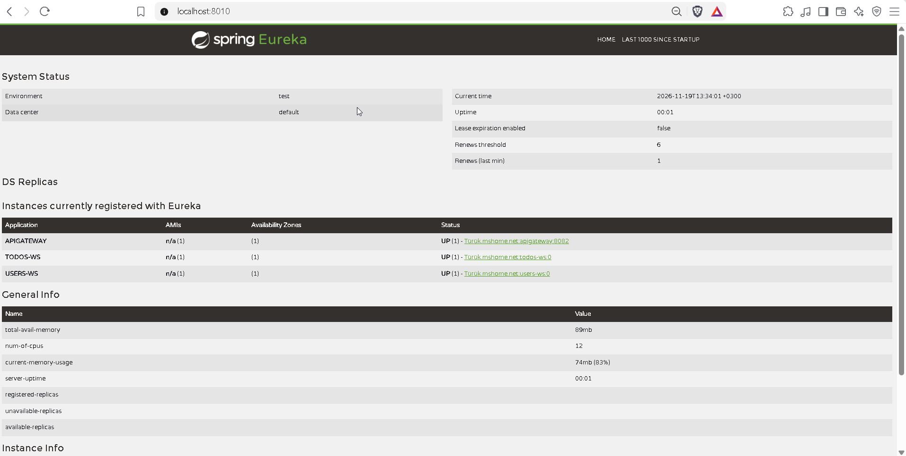

# Spring Cloud Microservices



A microservices architecture project built with Spring Boot 4.1.2

API Gateway – Single entry point for client requests. Handles request routing and JWT validation.

Users Service – Manages user registration, authentication, and JWT generation.

Todos Service – Manages Todo operations and connecting Todos with its authenticated owner.

All client requests are routed through the API Gateway.

| Method | Endpoint | Description |
|---|---|---|
| POST | `/api/auth/register` | Register a new user |
| POST | `/api/auth/login` | Authenticate user and obtain JWT |
| GET | `/api/user/status/check` | Check authentication status |
| POST | `/api/todos/create/todo` | Create a Todo |
| GET | `/api/todos` | List authenticated user's Todos |
| PUT | `/api/todos/{id}` | Toggle Todo completion |
| DELETE | `/api/todos/{id}` | Delete a Todo |

Protected endpoints require an access token:

```http
Authorization: Bearer <JWT_TOKEN>
```
